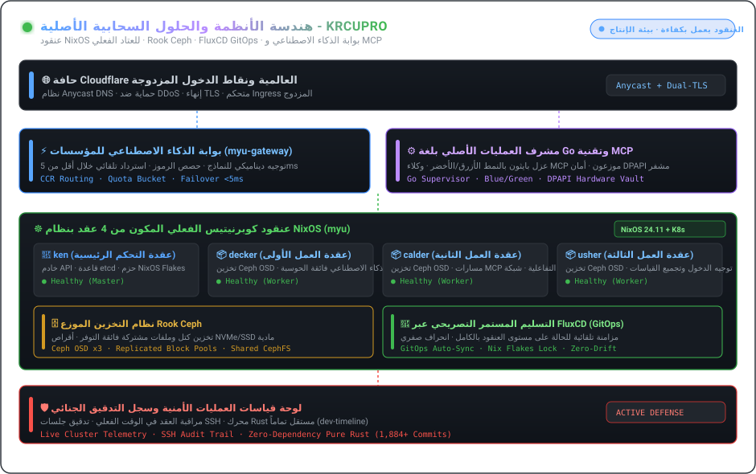

  <a href="./README.md"><strong>🇺🇸 English</strong></a> &nbsp;•&nbsp;
  <a href="./README.ko.md"><strong>🇰🇷 한국어</strong></a> &nbsp;•&nbsp;
  <a href="./README.ja.md"><strong>🇯🇵 日本語</strong></a> &nbsp;•&nbsp;
  <a href="./README.zh.md"><strong>🇨🇳 简体中文</strong></a> &nbsp;•&nbsp;
  <a href="./README.es.md"><strong>🇪🇸 Español</strong></a> 
  <a href="./README.fr.md"><strong>🇫🇷 Français</strong></a> &nbsp;•&nbsp;
  <a href="./README.de.md"><strong>🇩🇪 Deutsch</strong></a> &nbsp;•&nbsp;
  <a href="./README.ru.md"><strong>🇷🇺 Русский</strong></a> &nbsp;•&nbsp;
  <a href="./README.pt-BR.md"><strong>🇧🇷 Português</strong></a> &nbsp;•&nbsp;
  <a href="./README.ar.md"><strong>🇸🇦 العربية</strong></a>

  

 

### 💡 نظرة عامة (Executive Overview)

مرحبًا! أنا **KRCUPRO (조효준)** — مهندس أنظمة ومنصات سحابية أصلية (Cloud-Native) متخصص في البنية التحتية التصريحية للعتاد الفعلي (Bare-Metal)، والتخزين الموزع، وبوابات الذكاء الاصطناعي عالية الإنتاجية، وبيئات تشغيل الوكلاء الذاتية.

أقوم بتصميم أنظمة تلتقي فيها **قابلية إعادة الإنتاج التصريحية مع الأداء الفائق**: بدءًا من مجموعات NixOS الفعلية المكونة من 4 عقد وتعمل بتخزين Ceph، وحتى مشرفي Go الأصليين الذين يديرون تدفقات MCP الموزعة والخدمات المصغرة دون توقف.

---

  

### 🏛️ ركائز الهندسة والهياكل الأساسية

#### 1. 🌐 البنية التحتية للعتاد الفعلي و GitOps التصريحي
- **مجموعة فعلية من 4 عقد (`myu`)**: مجموعة Kubernetes على عتاد فعلي مُدارة بالكامل عبر NixOS Flakes (`ken` لوحة التحكم، `decker`، `calder`، `usher` عقد العمل).
- **التسليم المستمر عبر GitOps**: مزامنة تلقائية على مستوى المجموعة باستخدام **FluxCD**، لإدارة شبكات CNI، ومتحكمات الدخول المزدوجة، وإدارة دورة حياة TLS.
- **التخزين الموزع**: تكامل احترافي مع **Rook Ceph** لتوفير وحدات تخزين كتلية وأنظمة ملفات موزعة عالية التوافر عبر أقراص NVMe/SSD الفعلية.

#### 2. ⚡ بوابات الذكاء الاصطناعي، بروتوكولات MCP وبيئات التشغيل الذاتية
- **بوابات الذكاء الاصطناعي للمؤسسات**: وكلاء عكسيون وموجهات نماذج عالية التزامن (`myu-gateway`، `mcp-gateway`) مع دعم لحصص الرموز وتجاوز الفشل في أقل من 5 مللي ثانية.
- **مشرفو الوكلاء الأصليون**: بنية تحتية أصلية لـ Windows تعتمد على **مشرفي عمليات Go**، وعزل عمال Python (Blue/Green)، وتنفيذ أدوات متكافئ.
- **بروتوكول سياق النموذج (MCP)**: تنسيق خوادم MCP الموزعة مع أمان DPAPI المعتمد على العتاد وتوجيه Cloudflare الطرفي.

#### 3. 🛡️ التحليل الجنائي للأنظمة والدفاع النشط للبنية التحتية
- **لوحات تحكم SecOps والقياس عن بُعد**: قياس فوري للمجموعات متعددة العقد، وتدقيق جلسات SSH، ومجموعات التخفيف النشط.
- **أبحاث الأنظمة عديمة التبعيات**: تطبيقات تشفير دقيقة (AEAD، Ed25519، وقت ثابت) وتحليل جنائي للثنائيات (`dev-timeline`).

---

### 💻 المكدس التقني الشامل (Technology Stack)

| المجال | التقنيات والأدوات الأساسية |
| :--- | :--- |
| **اللغات وبيئات التشغيل** | `Go`, `Rust`, `TypeScript`, `Nix`, `Python`, `Shell (Bash / PowerShell)`, `SQL` |
| **السحابية الأصلية والتنسيق** | `Kubernetes (Kubeadm)`, `NixOS Flakes`, `FluxCD (GitOps)`, `Rook Ceph`, `Docker / Compose`, `Containerd` |
| **بوابات الذكاء الاصطناعي والبروتوكولات** | `Model Context Protocol (MCP)`, `Claude Code Router (CCR)`, `REST / gRPC`, `WebSocket`, `Webhooks` |
| **الحوسبة الطرفية والدخول والشبكات** | `Cloudflare Workers / D1 / Queues`, `Nginx`, `WireGuard`, `PCAP / تحليل الحزم` |
| **قابلية الرصد والأمان** | `لوحات قياس المجموعات عن بُعد`, `أنظمة تدقيق SSH`, `الدفاع النشط`, `تشفير الوقت الثابت` |

---

### 📁 أبرز المستودعات المعمارية (Featured Repositories)

- **[`kuber-nixos-config`](https://github.com/KRCUPRO/kuber-nixos-config)** — الأساس التصريحي للأجهزة المضيفة لمجموعة `myu` المكونة من 4 عقد (NixOS flakes، وتجهيز Ceph، وتنسيق Kubeadm).
- **[`kuber-infrastructure`](https://github.com/KRCUPRO/kuber-infrastructure)** — مستودع FluxCD GitOps لإدارة CNI، ومتحكمات الدخول، وفئات التخزين، وأحمال العمل.
- **[`chatgpt-windows-work`](https://github.com/KRCUPRO/chatgpt-windows-work)** — بيئة تشغيل MCP أصلية مع مشرف Go، وعزل عمال Blue/Green، ونقطة دخول Cloudflare.
- **[`ui-reference-screens`](https://github.com/KRCUPRO/ui-reference-screens)** — لوحة تحكم العمليات وشاشات مرجعية معمارية لبوابات API للمؤسسات.
- **[`dev-timeline`](https://github.com/KRCUPRO/dev-timeline)** — دفتر أبحاث الأنظمة وسجل التزامات التشفير والتحليل الجنائي الخالي من التبعيات (2022–حتى الآن).

---

  

    
  <i>"البساطة هي الشرط الأساسي للموثوقية. والحالة التصريحية هي الشرط الأساسي للسكينة."</i>

