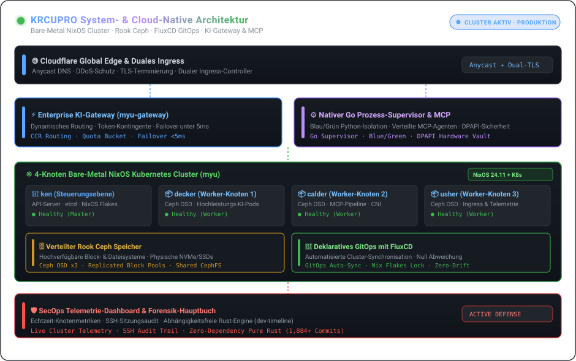

| [🇰🇷 한국어](./README.ko.md) | [🇺🇸 English](./README.md) | [🇯🇵 日本語](./README.ja.md) | [🇨🇳 简体中文](./README.zh.md) | [🇪🇸 Español](./README.es.md) |
| :---: | :---: | :---: | :---: | :---: |
| [🇫🇷 Français](./README.fr.md) | [🇩🇪 Deutsch](./README.de.md) | [🇷🇺 Русский](./README.ru.md) | [🇧🇷 Português](./README.pt-BR.md) | [🇸🇦 العربية](./README.ar.md) |

  

 

### 💡 Übersicht (Executive Overview)

Hallo! Ich bin **KRCUPRO (조효준)** — Systems & Cloud-Native Plattform-Ingenieur mit Spezialisierung auf deklarative Bare-Metal-Infrastruktur, verteilten Speicher, hochperformante KI-Gateways und autonome Agenten-Laufzeiten.

Ich entwickle Systeme, bei denen **deklarative Reproduzierbarkeit auf Spitzenleistung trifft**: von physischen 4-Knoten-NixOS-Clustern mit Ceph-Speicher bis hin zu nativen Go-Supervisoren, die verteilte MCP-Pipelines und ausfallsichere Microservices steuern.

---

  

### 🏛️ Engineering-Säulen & Kernarchitekturen

#### 1. 🌐 Bare-Metal-Infrastruktur & Deklaratives GitOps
- **Physischer 4-Knoten-Cluster (`myu`)**: Bare-Metal-Kubernetes-Cluster, orchestriert über NixOS Flakes (`ken` Control Plane, `decker`, `calder`, `usher` Worker-Nodes).
- **GitOps Continuous Delivery**: Vollautomatische clusterweite Synchronisation mittels **FluxCD**, CNI-Verwaltung, Dual-Ingress-Controller und TLS-Lifecycle.
- **Verteilter Speicher**: Produktionsreife **Rook Ceph**-Integration für hochverfügbare Block- und Dateisystem-Volumes auf physischen Festplatten.

#### 2. ⚡ KI-Gateways, MCP-Protokolle & Autonome Laufzeiten
- **Enterprise KI-Gateways**: Hochgradig nebenläufige Reverse Proxies und Routing-Engines (`myu-gateway`, `mcp-gateway`) mit Quoten-Management und Sub-5ms-Failover.
- **Native Agenten-Supervisoren**: Windows-native Agentenarchitektur mit **Go-Prozess-Supervisoren**, Blue/Green-Python-Worker-Isolation und idempotenter Tool-Ausführung.
- **Model Context Protocol (MCP)**: Orchestrierung verteilter MCP-Server mit hardwarebasierter DPAPI-Sicherheit und Cloudflare-Edge-Routing.

#### 3. 🛡️ Systemforensik & Aktive Infrastruktur-Verteidigung
- **SecOps & Telemetrie-Dashboards**: Echtzeit-Clustertelemetrie, SSH-Sitzungsüberwachung und aktive Abwehrmaßnahmen.
- **Abhängigkeitsfreie Systemforschung**: Strikte kryptographische Implementierungen (AEAD, Ed25519, Constant-Time) und Binärforensik (`dev-timeline`).

---

### 💻 Umfassender Technologie-Stack (Technology Stack)

| Bereich | Kerntechnologien & Werkzeuge |
| :--- | :--- |
| **Sprachen & Runtimes** | `Go`, `Rust`, `TypeScript`, `Nix`, `Python`, `Shell (Bash / PowerShell)`, `SQL` |
| **Cloud-Native & Orchestrierung** | `Kubernetes (Kubeadm)`, `NixOS Flakes`, `FluxCD (GitOps)`, `Rook Ceph`, `Docker / Compose`, `Containerd` |
| **KI-Gateways & Protokolle** | `Model Context Protocol (MCP)`, `Claude Code Router (CCR)`, `REST / gRPC`, `WebSocket`, `Webhooks` |
| **Edge, Ingress & Netzwerk** | `Cloudflare Workers / D1 / Queues`, `Nginx`, `WireGuard`, `PCAP / Paketanalyse` |
| **Observability & Sicherheit** | `Cluster-Telemetrie-Dashboards`, `SSH-Auditing`, `Aktive Verteidigung`, `Constant-Time-Kryptographie` |

---

### 📁 Hervorgehobene Architektur-Repositories

- **[`kuber-nixos-config`](https://github.com/KRCUPRO/kuber-nixos-config)** — Deklarative Host-Basis für den 4-Knoten `myu`-Cluster (NixOS flakes, Ceph, Kubeadm).
- **[`kuber-infrastructure`](https://github.com/KRCUPRO/kuber-infrastructure)** — FluxCD GitOps-Repository für CNI, Ingress, Speicherklassen und Cluster-Workloads.
- **[`chatgpt-windows-work`](https://github.com/KRCUPRO/chatgpt-windows-work)** — Native MCP-Laufzeit mit Go-Supervisor, Blue/Green-Workern und Cloudflare-Ingress.
- **[`ui-reference-screens`](https://github.com/KRCUPRO/ui-reference-screens)** — Operations-Konsole und Referenzoberflächen für Unternehmens-API-Gateways.
- **[`dev-timeline`](https://github.com/KRCUPRO/dev-timeline)** — Systemforschungsjournal und abhängigkeitsfreies Commit-Hauptbuch (2022–heute).

---

  

    
  <i>"Einfachheit ist die Voraussetzung für Zuverlässigkeit. Deklarativer Zustand ist die Voraussetzung für Gelassenheit."</i>

