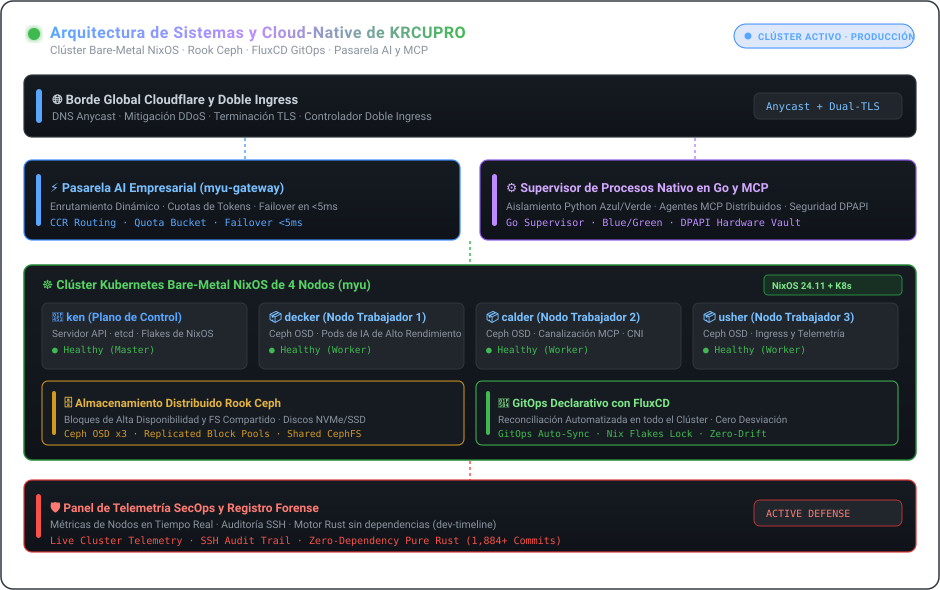

  <a href="./README.md"><strong>🇺🇸 English</strong></a> &nbsp;•&nbsp;
  <a href="./README.ko.md"><strong>🇰🇷 한국어</strong></a> &nbsp;•&nbsp;
  <a href="./README.ja.md"><strong>🇯🇵 日本語</strong></a> &nbsp;•&nbsp;
  <a href="./README.zh.md"><strong>🇨🇳 简体中文</strong></a> &nbsp;•&nbsp;
  <a href="./README.es.md"><strong>🇪🇸 Español</strong></a> 
  <a href="./README.fr.md"><strong>🇫🇷 Français</strong></a> &nbsp;•&nbsp;
  <a href="./README.de.md"><strong>🇩🇪 Deutsch</strong></a> &nbsp;•&nbsp;
  <a href="./README.ru.md"><strong>🇷🇺 Русский</strong></a> &nbsp;•&nbsp;
  <a href="./README.pt-BR.md"><strong>🇧🇷 Português</strong></a> &nbsp;•&nbsp;
  <a href="./README.ar.md"><strong>🇸🇦 العربية</strong></a>

  

 

### 💡 Resumen Ejecutivo (Executive Overview)

¡Hola! Soy **KRCUPRO (조효준)** — un Ingeniero de Sistemas y Plataformas Cloud-Native especializado en infraestructura bare-metal declarativa, almacenamiento distribuido, pasarelas de IA de alto rendimiento y entornos de ejecución para agentes autónomos.

Diseño sistemas donde **la reproducibilidad declarativa se une al máximo rendimiento**: desde clústeres físicos NixOS de 4 nodos con almacenamiento Ceph hasta supervisores nativos en Go que orquestan pipelines MCP distribuidos y microservicios sin tiempo de inactividad.

---

  

### 🏛️ Pilares de Ingeniería y Arquitecturas Centrales

#### 1. 🌐 Infraestructura Bare-Metal y GitOps Declarativo
- **Clúster Físico de 4 Nodos (`myu`)**: Clúster Kubernetes bare-metal orquestado mediante NixOS Flakes (`ken` plano de control, `decker`, `calder`, `usher` nodos de trabajo).
- **Entrega Continua GitOps**: Reconciliación automatizada a nivel de clúster con **FluxCD**, gestionando CNI, controladores dual-ingress y ciclo de vida TLS.
- **Almacenamiento Distribuido**: Integración de **Rook Ceph** de nivel de producción que proporciona volúmenes de bloques y sistemas de archivos distribuidos sobre discos físicos.

#### 2. ⚡ Pasarelas de IA, Protocolos MCP y Runtimes Autónomos
- **Pasarelas de IA Empresariales**: Proxies inversos de alta concurrencia y enrutadores de modelos (`myu-gateway`, `mcp-gateway`) con control de cuotas y failover menor a 5ms.
- **Supervisores Nativos de Agentes**: Arquitectura nativa para Windows con **supervisores de procesos en Go**, aislamiento blue/green en Python y ejecución idempotente.
- **Model Context Protocol (MCP)**: Encadenamiento de servidores MCP distribuidos con seguridad física DPAPI y enrutamiento edge con Cloudflare.

#### 3. 🛡️ Informática Forense y Defensa Activa
- **SecOps y Paneles de Telemetría**: Telemetría en tiempo real de clústeres multinodo, auditoría de sesiones SSH y suites de mitigación activa.
- **Investigación de Sistemas sin Dependencias**: Implementaciones criptográficas rigurosas (AEAD, Ed25519, tiempo constante) e ingeniería forense (`dev-timeline`).

---

### 💻 Stack Tecnológico Integral (Technology Stack)

| Dominio | Tecnologías y Herramientas |
| :--- | :--- |
| **Lenguajes y Runtimes** | `Go`, `Rust`, `TypeScript`, `Nix`, `Python`, `Shell (Bash / PowerShell)`, `SQL` |
| **Cloud-Native y Orquestación** | `Kubernetes (Kubeadm)`, `NixOS Flakes`, `FluxCD (GitOps)`, `Rook Ceph`, `Docker / Compose`, `Containerd` |
| **Pasarelas de IA y Protocolos** | `Model Context Protocol (MCP)`, `Claude Code Router (CCR)`, `REST / gRPC`, `WebSocket`, `Webhooks` |
| **Edge, Ingress y Redes** | `Cloudflare Workers / D1 / Queues`, `Nginx`, `WireGuard`, `PCAP / Análisis de paquetes` |
| **Observabilidad y Seguridad** | `Paneles de telemetría de clúster`, `Auditoría SSH`, `Defensa activa`, `Criptografía en tiempo constante` |

---

### 📁 Repositorios Arquitectónicos Destacados

- **[`kuber-nixos-config`](https://github.com/KRCUPRO/kuber-nixos-config)** — Base declarativa de hosts para el clúster `myu` de 4 nodos (NixOS flakes, Ceph, Kubeadm).
- **[`kuber-infrastructure`](https://github.com/KRCUPRO/kuber-infrastructure)** — Repositorio GitOps con FluxCD que administra CNI, Ingress y cargas de trabajo del clúster.
- **[`chatgpt-windows-work`](https://github.com/KRCUPRO/chatgpt-windows-work)** — Runtime nativo de MCP con supervisor Go, aislamiento blue/green e ingreso Cloudflare.
- **[`ui-reference-screens`](https://github.com/KRCUPRO/ui-reference-screens)** — Consola de operaciones y pantallas de referencia para pasarelas de API empresariales.
- **[`dev-timeline`](https://github.com/KRCUPRO/dev-timeline)** — Registro de investigación de sistemas y criptografía sin dependencias externas (2022–presente).

---

  

    
  <i>"La simplicidad es el prerrequisito para la confiabilidad. El estado declarativo es el prerrequisito para la tranquilidad."</i>

