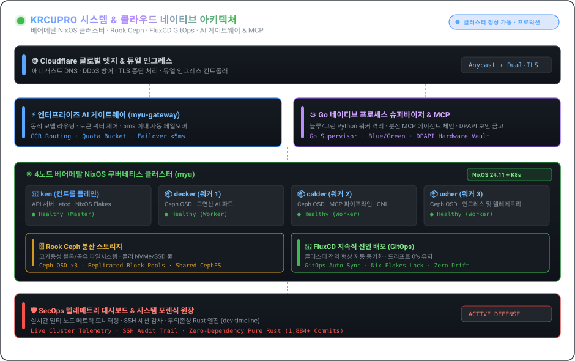

| [🇰🇷 한국어](./README.ko.md) | [🇺🇸 English](./README.md) | [🇯🇵 日本語](./README.ja.md) | [🇨🇳 简体中文](./README.zh.md) | [🇪🇸 Español](./README.es.md) |
| :---: | :---: | :---: | :---: | :---: |
| [🇫🇷 Français](./README.fr.md) | [🇩🇪 Deutsch](./README.de.md) | [🇷🇺 Русский](./README.ru.md) | [🇧🇷 Português](./README.pt-BR.md) | [🇸🇦 العربية](./README.ar.md) |

  

 

### 💡 개요 (Executive Overview)

안녕하세요! 선언적 베어메탈 인프라, 분산 스토리지, 고처리량 AI 게이트웨이 및 자율 에이전트 런타임을 전문으로 설계하는 시스템 & 클라우드 네이티브 엔지니어 **KRCUPRO (조효준)** 입니다.

**선언적 재현성과 고성능 실행력이 공존하는 아키텍처**를 만듭니다. Rook Ceph 분산 스토리지를 탑재한 4노드 물리 NixOS 클러스터부터, 분산 MCP 파이프라인을 지휘하는 Go 슈퍼바이저 및 무중단 마이크로서비스에 이르기까지 타협 없는 엔지니어링을 지향합니다.

---

  

### 🏛️ 핵심 엔지니어링 기둥 & 아키텍처 (Pillars)

#### 1. 🌐 베어메탈 인프라 & 선언적 GitOps
- **4노드 물리 클러스터 (`myu`)**: NixOS Flakes 기반으로 선언된 베어메탈 Kubernetes 클러스터 운영 (`ken` 컨트롤 플레인, `decker`, `calder`, `usher` 워커 노드).
- **GitOps 지속적 배포**: **FluxCD**를 활용한 클러스터 전역 자동 동기화, CNI, 듀얼 인그레스 컨트롤러 및 자동화된 TLS 라이프사이클 관리.
- **분산 스토리지**: 물리 NVMe/SSD 디스크를 묶어 고가용성 블록 및 분산 파일시스템 볼륨을 제공하는 **Rook Ceph** 구축 및 운영.

#### 2. ⚡ AI 게이트웨이, MCP 프로토콜 & 자율 런타임
- **엔터프라이즈 AI 게이트웨이**: 토큰 쿼터 제어, 채널 로드밸런싱 및 5ms 이내 자동 페일오버를 지원하는 고동시성 리버스 프록시/라우터 (`myu-gateway`, `mcp-gateway`).
- **네이티브 에이전트 슈퍼바이저**: **Go 프로세스 슈퍼바이저**, 블루/그린 Python 워커 격리, 멱등 도구 실행 엔진 기반의 Windows 네이티브 에이전트 아키텍처.
- **Model Context Protocol (MCP)**: 하드웨어 보안 금고(DPAPI) 및 Cloudflare 엣지 라우팅과 결합된 분산 MCP 도구 체인 오케스트레이션.

#### 3. 🛡️ 시스템 포렌식 & 능동형 인프라 방어
- **SecOps & 텔레메트리 대시보드**: 멀티 노드 클러스터 실시간 텔레메트리, SSH 세션 감사 및 능동 완화 스위트.
- **무의존성 저수준 연구**: 정밀 암호학 구현체(AEAD, Ed25519, 상수 시간 검증) 및 무할당 바이너리 포렌식 파이프라인 (`dev-timeline`).

---

### 💻 종합 기술 스택 (Technology Stack)

| 도메인 | 핵심 기술 및 도구 |
| :--- | :--- |
| **언어 & 런타임** | `Go`, `Rust`, `TypeScript`, `Nix`, `Python`, `Shell (Bash / PowerShell)`, `SQL` |
| **클라우드 네이티브 & 오케스트레이션** | `Kubernetes (Kubeadm)`, `NixOS Flakes`, `FluxCD (GitOps)`, `Rook Ceph`, `Docker / Compose`, `Containerd` |
| **AI 게이트웨이 & 프로토콜** | `Model Context Protocol (MCP)`, `Claude Code Router (CCR)`, `REST / gRPC`, `WebSocket`, `Webhooks` |
| **엣지, 인그레스 & 네트워크** | `Cloudflare Workers / D1 / Queues`, `Nginx`, `WireGuard`, `PCAP / 패킷 포렌식` |
| **관측성 & 보안** | `클러스터 텔레메트리 대시보드`, `SSH 감사 시스템`, `능동 방어`, `상수 시간 암호학` |

---

### 📁 주요 아키텍처 저장소 (Featured Repositories)

- **[`kuber-nixos-config`](https://github.com/KRCUPRO/kuber-nixos-config)** — 4노드 `myu` 클러스터의 호스트 선언적 기반 (NixOS flakes, Ceph 사전구성, Kubeadm 조율).
- **[`kuber-infrastructure`](https://github.com/KRCUPRO/kuber-infrastructure)** — CNI, Ingress, 스토리지 클래스 및 클러스터 워크로드를 관리하는 FluxCD GitOps 저장소.
- **[`chatgpt-windows-work`](https://github.com/KRCUPRO/chatgpt-windows-work)** — Go 슈퍼바이저, 블루/그린 워커, Cloudflare 인그레스를 갖춘 네이티브 MCP 런타임.
- **[`ui-reference-screens`](https://github.com/KRCUPRO/ui-reference-screens)** — 엔터프라이즈 API 게이트웨이 운영 콘솔 및 아키텍처 화면 레퍼런스.
- **[`dev-timeline`](https://github.com/KRCUPRO/dev-timeline)** — 무의존성 순수 암호학 및 포렌식 연구 커밋 원장 (2022–현재).

---

  

    
  <i>"단순함은 신뢰성의 전제조건이며, 선언적 상태는 평온함의 전제조건이다."</i>

