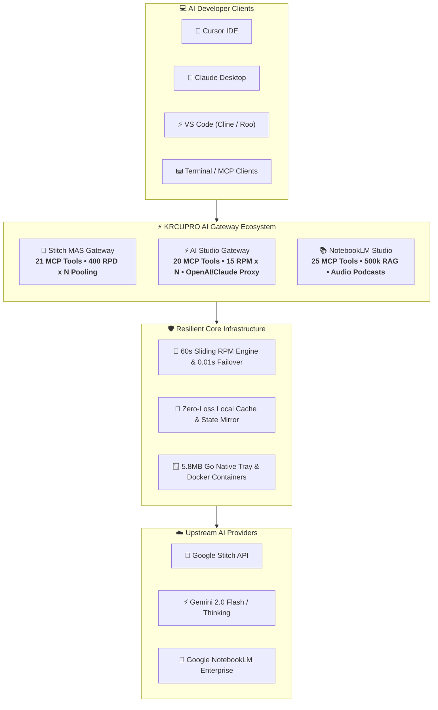
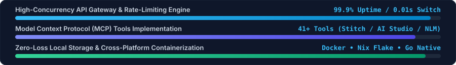

<div align="center">
  <a href="https://github.com/KRCUPRO">
    
  </a>
</div>

<p align="center">
  <a href="https://github.com/KRCUPRO">
    
  </a>
</p>

<p align="center">
  <a href="https://github.com/KRCUPRO"></a>
  <a href="https://github.com/KRCUPRO/Stitch_MAS_Gateway"></a>
  <a href="https://github.com/KRCUPRO"></a>
  <a href="https://github.com/KRCUPRO"></a>
</p>

---

## ⚡ System Diagnostics & Profile

```typescript
interface SystemArchitect {
  readonly name: "조효준 (Hyojun Cho)";
  readonly alias: "KRCUPRO";
  readonly role: "AI Systems Architect & Full-Stack / Native Engineer";
  readonly coreCompetencies: [
    "High-Concurrency AI Gateway Architecture",
    "Model Context Protocol (MCP) Standard Implementation",
    "Sliding-Window RPM/RPD Quota Management & 0.01s Failover",
    "Zero-Loss Local State Persistence & Asset Mirroring",
    "Lightweight Native Binaries (Go 1.22 / Windows Tray / Webview)",
    "Declarative Containerization (Docker Multi-Stage, NixOS Flakes)"
  ];
  readonly mission: "Building resilient, zero-interruption bridges between frontier AI models and developer workflows.";
}
```

---

## 🏛️ Ecosystem Architecture



---

## 📈 Engineering Performance Metrics

<div align="center">
  <a href="https://github.com/KRCUPRO">
    
  </a>
</div>

---

## 🛠️ Production Tech Stack & Tooling

<table>
  <thead>
    <tr>
      <th width="20%">Domain</th>
      <th width="80%">Technologies &amp; Frameworks</th>
    </tr>
  </thead>
  <tbody>
    <tr>
      <td><strong>Core Languages</strong></td>
      <td>
        <a href="https://www.typescriptlang.org/"></a>
        <a href="https://developer.mozilla.org/en-US/docs/Web/JavaScript"></a>
        <a href="https://go.dev/"></a>
        <a href="https://www.python.org/"></a>
        <a href="https://learn.microsoft.com/powershell/"></a>
      </td>
    </tr>
    <tr>
      <td><strong>Frontend &amp; UI</strong></td>
      <td>
        <a href="https://react.dev/"></a>
        <a href="https://vitejs.dev/"></a>
        <a href="https://tailwindcss.com/"></a>
        <a href="https://lucide.dev/"></a>
      </td>
    </tr>
    <tr>
      <td><strong>Backend &amp; Protocols</strong></td>
      <td>
        <a href="https://nodejs.org/"></a>
        <a href="https://expressjs.com/"></a>
        <a href="https://modelcontextprotocol.io/"></a>
        <a href="https://platform.openai.com/"></a>
        <a href="https://docs.anthropic.com/"></a>
      </td>
    </tr>
    <tr>
      <td><strong>DevOps &amp; OS</strong></td>
      <td>
        <a href="https://www.docker.com/"></a>
        <a href="https://nixos.org/"></a>
        <a href="https://github.com/features/actions"></a>
        <a href="https://ubuntu.com/"></a>
        <a href="https://microsoft.com/windows"></a>
      </td>
    </tr>
  </tbody>
</table>

---

## 🚀 Featured AI Gateway Ecosystem

<table>
  <tr>
    <td width="33%" valign="top">
      <h3>🧵 <a href="https://github.com/KRCUPRO/Stitch_MAS_Gateway">Stitch_MAS_Gateway</a></h3>
      <p><strong>Google Stitch Multi-Key MCP Gateway &amp; Studio</strong></p>
      <ul>
        <li>다중 API 키 풀링 및 <strong>N × 400 RPD</strong> 쿼터 합산</li>
        <li><strong>0.01초 무중단</strong> 429 페일오버 &amp; Zero-Loss 로컬 미러</li>
        <li><strong>21종 풀세트 MCP 도구</strong> (생성, 수정, 변형, 코드 변환)</li>
        <li>5.8MB Go 트레이 런처 + Docker + NixOS 완벽 지원</li>
      </ul>
      <p>
        <a href="https://github.com/KRCUPRO/Stitch_MAS_Gateway"></a>
        <a href="https://github.com/KRCUPRO/Stitch_MAS_Gateway"></a>
        <a href="https://github.com/KRCUPRO/Stitch_MAS_Gateway"></a>
      </p>
    </td>
    <td width="33%" valign="top">
      <h3>⚡ <a href="https://github.com/KRCUPRO/Google_AI_Studio_MAS_Gateway">Google_AI_Studio_MAS_Gateway</a></h3>
      <p><strong>Google AI Studio Multi-Key Proxy &amp; Gateway</strong></p>
      <ul>
        <li><strong>N × 15 RPM / N × 1,500 RPD</strong> 정밀 슬라이딩 윈도우 감쇄</li>
        <li>OpenAI (<code>/v1/chat/completions</code>) &amp; Claude (<code>/v1/messages</code>) 양방향 프록시</li>
        <li>Gemini 2.0 Thinking CoT 및 Imagen 3 <strong>20종 MCP 도구</strong></li>
        <li>Windows 11 Fluent 대시보드 및 원클릭 콘솔 매니저</li>
      </ul>
      <p>
        <a href="https://github.com/KRCUPRO/Google_AI_Studio_MAS_Gateway"></a>
        <a href="https://github.com/KRCUPRO/Google_AI_Studio_MAS_Gateway"></a>
        <a href="https://github.com/KRCUPRO/Google_AI_Studio_MAS_Gateway"></a>
      </p>
    </td>
    <td width="33%" valign="top">
      <h3>📚 <a href="https://github.com/KRCUPRO/NotebookLM_Gateway">NotebookLM_Gateway</a></h3>
      <p><strong>NotebookLM Multi-Session Studio &amp; RPC Engine</strong></p>
      <ul>
        <li>batchexecute RPC 프로토콜 바인딩 &amp; SAPISIDHASH 자동 서명</li>
        <li><strong>50만 토큰 다중 소스 RAG</strong> 질의 &amp; Deep Research</li>
        <li>오디오 팟캐스트(Audio Overview) 생성 &amp; <strong>25종 MCP 도구</strong></li>
        <li>Windows 11 네이티브 Fluent Studio UI 탑재</li>
      </ul>
      <p>
        <a href="https://github.com/KRCUPRO/NotebookLM_Gateway"></a>
        <a href="https://github.com/KRCUPRO/NotebookLM_Gateway"></a>
        <a href="https://github.com/KRCUPRO/NotebookLM_Gateway"></a>
      </p>
    </td>
  </tr>
</table>

---

## 🏆 Engineering Highlights & Guarantees

<div align="center">
  <a href="https://github.com/KRCUPRO"></a>
  <a href="https://github.com/KRCUPRO"></a>
  <a href="https://github.com/KRCUPRO"></a>
  <a href="https://github.com/KRCUPRO"></a>
</div>

<br />

<p align="center">
  <sub>Designed &amp; Engineered by <strong>Hyojun Cho (KRCUPRO)</strong> • © 2026 All Rights Reserved</sub>
</p>
