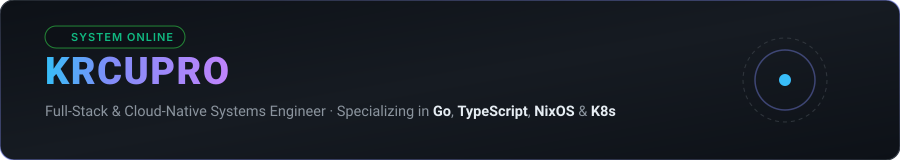
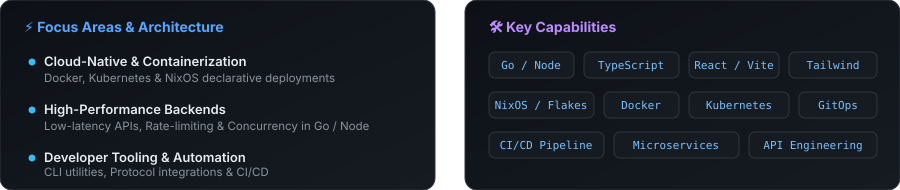

  <a href="./README.md"><strong>🇺🇸 English</strong></a> &nbsp;•&nbsp;
  <a href="./README.ko.md"><strong>🇰🇷 한국어</strong></a> &nbsp;•&nbsp;
  <a href="./README.ja.md"><strong>🇯🇵 日本語</strong></a> &nbsp;•&nbsp;
  <a href="./README.zh.md"><strong>🇨🇳 简体中文</strong></a> &nbsp;•&nbsp;
  <a href="./README.es.md"><strong>🇪🇸 Español</strong></a> 
  <a href="./README.fr.md"><strong>🇫🇷 Français</strong></a> &nbsp;•&nbsp;
  <a href="./README.de.md"><strong>🇩🇪 Deutsch</strong></a> &nbsp;•&nbsp;
  <a href="./README.ru.md"><strong>🇷🇺 Русский</strong></a> &nbsp;•&nbsp;
  <a href="./README.pt-BR.md"><strong>🇧🇷 Português</strong></a> &nbsp;•&nbsp;
  <a href="./README.ar.md"><strong>🇸🇦 العربية</strong></a>

  

 

### 💡 About Me

Hey there! I am **KRCUPRO**, a software engineer passionate about clean code, high-throughput systems, and declarative infrastructure.

- 🔭 **Focus**: Architecting scalable microservices, low-latency APIs, and resilient container platforms.
- ⚡ **Stack**: Deeply invested in **Go**, **TypeScript**, **Docker**, and **NixOS**.
- 🛠️ **Philosophy**: I value simplicity, automation, and building systems that are robust by design.
- 🌱 **Learning**: Constantly exploring emerging tech, optimizing system performance, and refining developer tooling.

---

### 💻 Tech Stack

- **Languages:** `Go`, `TypeScript`, `JavaScript`, `Python`, `Shell Script`, `SQL`
- **Backend & APIs:** `Node.js`, `Express`, `RESTful APIs`, `gRPC`, `WebSocket`, `Microservices`
- **Frontend & UI:** `React`, `Vite`, `Tailwind CSS`, `HTML5 / CSS3`
- **Cloud & DevOps:** `Docker`, `Docker Compose`, `Kubernetes`, `NixOS / Flakes`, `GitHub Actions`, `Linux`

---

  

    
  <i>"Simplicity is prerequisite for reliability."</i>

