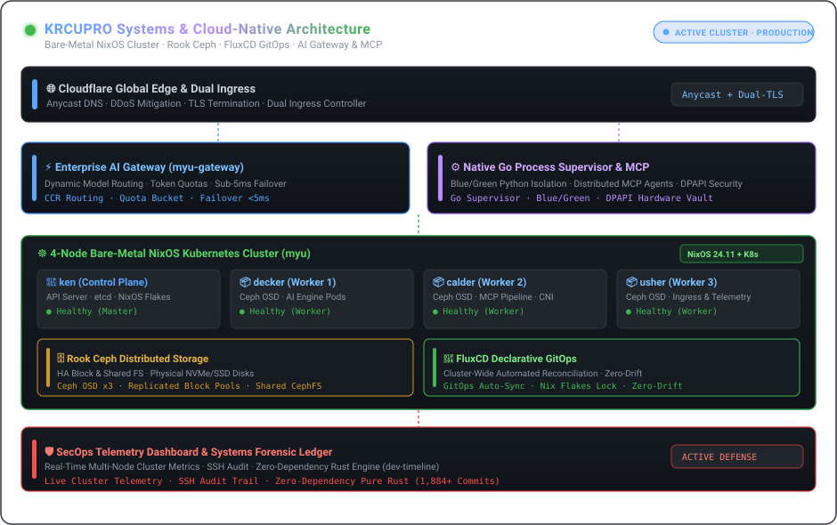

| [🇰🇷 한국어](./README.ko.md) | [🇺🇸 English](./README.md) | [🇯🇵 日本語](./README.ja.md) | [🇨🇳 简体中文](./README.zh.md) | [🇪🇸 Español](./README.es.md) |
| :---: | :---: | :---: | :---: | :---: |
| [🇫🇷 Français](./README.fr.md) | [🇩🇪 Deutsch](./README.de.md) | [🇷🇺 Русский](./README.ru.md) | [🇧🇷 Português](./README.pt-BR.md) | [🇸🇦 العربية](./README.ar.md) |

  

 

### 💡 Executive Overview

Hi, I am **KRCUPRO (조효준)** — a Systems & Cloud-Native Platform Engineer specializing in declarative bare-metal infrastructure, distributed storage, high-throughput AI gateways, and autonomous agent runtimes.

I design systems where **declarative reproducibility meets high-performance execution**: from 4-node physical NixOS clusters running Ceph storage to native Go supervisors steering distributed MCP pipelines and zero-downtime microservices.

---

  

### 🏛️ Engineering Pillars & Core Architectures

#### 1. 🌐 Bare-Metal Infrastructure & Declarative GitOps
- **4-Node Physical Cluster (`myu`)**: Designed and operating a bare-metal Kubernetes cluster orchestrated via NixOS Flakes (`ken` control plane, `decker`, `calder`, `usher` worker nodes).
- **GitOps Continuous Delivery**: Fully automated cluster-wide reconciliation using **FluxCD**, managing CNIs, dual-ingress controllers, and automated TLS lifecycle.
- **Distributed Storage**: Production-grade **Rook Ceph** integration providing highly available block and shared filesystem volumes across physical NVMe/SSD disks.

#### 2. ⚡ AI Gateways, MCP Protocols & Autonomous Runtimes
- **Enterprise AI Gateways**: High-concurrency reverse proxy and model routing engines (`myu-gateway`, `mcp-gateway`) featuring token quota enforcement, channel load-balancing, and sub-5ms failover.
- **Native Agent Supervisors**: Windows-native agent architectures with **Go process supervisors**, blue/green Python worker isolation, and idempotent tool calling engines.
- **Model Context Protocol (MCP)**: Chaining and orchestrating distributed MCP servers with hardware-backed DPAPI security and edge Cloudflare routing.

#### 3. 🛡️ Systems Forensics & Active Infrastructure Defense
- **SecOps & Audit Dashboards**: Real-time multi-node cluster telemetry, SSH session auditing, and active mitigation suites.
- **Zero-Dependency Systems Research**: Rigorous cryptography implementations (AEAD, Ed25519, constant-time validation) and zero-allocation binary forensics (`dev-timeline`).

---

### 💻 Comprehensive Technology Stack

| Domain | Core Technologies & Tooling |
| :--- | :--- |
| **Languages & Runtimes** | `Go`, `Rust`, `TypeScript`, `Nix`, `Python`, `Shell (Bash / PowerShell)`, `SQL` |
| **Cloud-Native & Orchestration** | `Kubernetes (Kubeadm)`, `NixOS Flakes`, `FluxCD (GitOps)`, `Rook Ceph`, `Docker / Compose`, `Containerd` |
| **AI Gateways & Protocols** | `Model Context Protocol (MCP)`, `Claude Code Router (CCR)`, `REST / gRPC`, `WebSocket`, `Webhooks` |
| **Edge, Ingress & Networking** | `Cloudflare Workers / D1 / Queues`, `Nginx`, `WireGuard`, `PCAP / Packet Forensics` |
| **Observability & Security** | `Cluster Telemetry Dashboards`, `SSH Audit Systems`, `Active Defense`, `Constant-Time Cryptography` |

---

### 📁 Featured Systems & Architectural Repositories

- **[`kuber-nixos-config`](https://github.com/KRCUPRO/kuber-nixos-config)** — Declarative host foundation for the 4-node `myu` cluster (NixOS flakes, Ceph prep, Kubeadm orchestration).
- **[`kuber-infrastructure`](https://github.com/KRCUPRO/kuber-infrastructure)** — FluxCD GitOps repository managing CNI, Ingress, storage classes, and cluster-wide workloads.
- **[`chatgpt-windows-work`](https://github.com/KRCUPRO/chatgpt-windows-work)** — Native MCP runtime with Go process supervisor, blue/green workers, and Cloudflare ingress.
- **[`ui-reference-screens`](https://github.com/KRCUPRO/ui-reference-screens)** — Standalone operations console and architectural reference screens for enterprise API gateways.
- **[`dev-timeline`](https://github.com/KRCUPRO/dev-timeline)** — Systems research journal and pure zero-dependency cryptography/forensics commit ledger (2022–present).

---

  

    
  <i>"Simplicity is prerequisite for reliability. Declarative state is prerequisite for serenity."</i>

