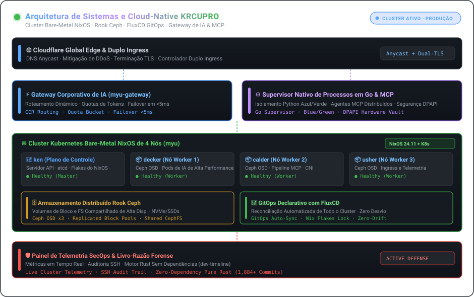

| [🇰🇷 한국어](./README.ko.md) | [🇺🇸 English](./README.md) | [🇯🇵 日本語](./README.ja.md) | [🇨🇳 简体中文](./README.zh.md) | [🇪🇸 Español](./README.es.md) |
| :---: | :---: | :---: | :---: | :---: |
| [🇫🇷 Français](./README.fr.md) | [🇩🇪 Deutsch](./README.de.md) | [🇷🇺 Русский](./README.ru.md) | [🇧🇷 Português](./README.pt-BR.md) | [🇸🇦 العربية](./README.ar.md) |

  

 

### 💡 Visão Executiva (Executive Overview)

Olá! Eu sou **KRCUPRO (조효준)** — Engenheiro de Sistemas e Plataformas Cloud-Native especializado em infraestrutura bare-metal declarativa, armazenamento distribuído, gateways de IA de alto rendimento e ambientes de execução para agentes autônomos.

Projeto sistemas onde **a reprodutibilidade declarativa encontra o desempenho extremo**: desde clusters físicos NixOS de 4 nós com armazenamento Ceph até supervisores nativos em Go orquestrando pipelines MCP distribuídos e microsserviços de alta disponibilidade.

---

  

### 🏛️ Pilares de Engenharia e Arquitetura

#### 1. 🌐 Infraestrutura Bare-Metal e GitOps Declarativo
- **Cluster Físico de 4 Nós (`myu`)**: Cluster Kubernetes bare-metal orquestrado via NixOS Flakes (`ken` plano de controle, `decker`, `calder`, `usher` nós de trabalho).
- **Entrega Contínua GitOps**: Reconciliação automatizada em todo o cluster usando **FluxCD**, gerenciando CNI, controladores dual-ingress e ciclo de vida de certificados TLS.
- **Armazenamento Distribuído**: Integração de **Rook Ceph** de nível de produção fornecendo volumes de blocos e sistemas de arquivos distribuídos de alta disponibilidade.

#### 2. ⚡ Gateways de IA, Protocolos MCP e Runtimes Autônomos
- **Gateways de IA Empresariais**: Proxies reversos e roteadores de modelos de alta concorrência (`myu-gateway`, `mcp-gateway`) com cotas de tokens e failover abaixo de 5ms.
- **Supervisores Nativos de Agentes**: Arquitetura nativa para Windows com **supervisores de processos em Go**, isolamento blue/green em Python e execução idempotente de ferramentas.
- **Model Context Protocol (MCP)**: Orquestração de servidores MCP distribuídos com segurança de hardware DPAPI e roteamento edge Cloudflare.

#### 3. 🛡️ Perícia de Sistemas e Defesa Ativa de Infraestrutura
- **SecOps e Painéis de Telemetria**: Telemetria de cluster multinó em tempo real, auditoria de sessões SSH e suítes de mitigação ativa.
- **Pesquisa de Sistemas sem Dependências**: Implementações criptográficas rigorosas (AEAD, Ed25519, tempo constante) e análise binária de zero alocação (`dev-timeline`).

---

### 💻 Stack Tecnológico Abrangente (Technology Stack)

| Domínio | Principais Tecnologias e Ferramentas |
| :--- | :--- |
| **Linguagens e Runtimes** | `Go`, `Rust`, `TypeScript`, `Nix`, `Python`, `Shell (Bash / PowerShell)`, `SQL` |
| **Cloud-Native e Orquestração** | `Kubernetes (Kubeadm)`, `NixOS Flakes`, `FluxCD (GitOps)`, `Rook Ceph`, `Docker / Compose`, `Containerd` |
| **Gateways de IA e Protocolos** | `Model Context Protocol (MCP)`, `Claude Code Router (CCR)`, `REST / gRPC`, `WebSocket`, `Webhooks` |
| **Edge, Ingress e Redes** | `Cloudflare Workers / D1 / Queues`, `Nginx`, `WireGuard`, `PCAP / Análise de pacotes` |
| **Observabilidade e Segurança** | `Painéis de telemetria de cluster`, `Auditoria SSH`, `Defesa ativa`, `Criptografia de tempo constante` |

---

### 📁 Repositórios Arquiteturais em Destaque

- **[`kuber-nixos-config`](https://github.com/KRCUPRO/kuber-nixos-config)** — Base declarativa de hosts para o cluster `myu` de 4 nós (NixOS flakes, Ceph, Kubeadm).
- **[`kuber-infrastructure`](https://github.com/KRCUPRO/kuber-infrastructure)** — Repositório GitOps FluxCD que gerencia CNI, Ingress e cargas de trabalho do cluster.
- **[`chatgpt-windows-work`](https://github.com/KRCUPRO/chatgpt-windows-work)** — Runtime nativo de MCP com supervisor Go, isolamento blue/green e ingresso Cloudflare.
- **[`ui-reference-screens`](https://github.com/KRCUPRO/ui-reference-screens)** — Console de operações e telas de referência para gateways de API corporativos.
- **[`dev-timeline`](https://github.com/KRCUPRO/dev-timeline)** — Diário de pesquisa de sistemas e registro de commits sem dependências externas (2022–presente).

---

  

    
  <i>"A simplicidade é o pré-requisito para a confiabilidade. O estado declarativo é o pré-requisito para a tranquilidade."</i>

