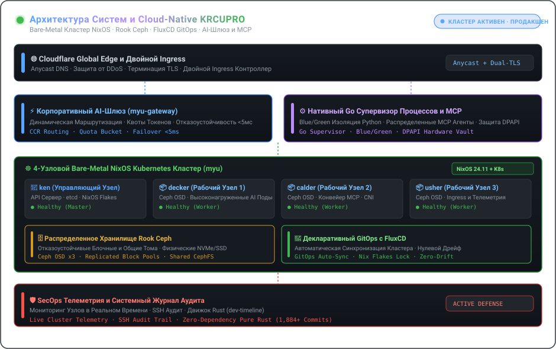

  <a href="./README.md"><strong>🇺🇸 English</strong></a> &nbsp;•&nbsp;
  <a href="./README.ko.md"><strong>🇰🇷 한국어</strong></a> &nbsp;•&nbsp;
  <a href="./README.ja.md"><strong>🇯🇵 日本語</strong></a> &nbsp;•&nbsp;
  <a href="./README.zh.md"><strong>🇨🇳 简体中文</strong></a> &nbsp;•&nbsp;
  <a href="./README.es.md"><strong>🇪🇸 Español</strong></a> 
  <a href="./README.fr.md"><strong>🇫🇷 Français</strong></a> &nbsp;•&nbsp;
  <a href="./README.de.md"><strong>🇩🇪 Deutsch</strong></a> &nbsp;•&nbsp;
  <a href="./README.ru.md"><strong>🇷🇺 Русский</strong></a> &nbsp;•&nbsp;
  <a href="./README.pt-BR.md"><strong>🇧🇷 Português</strong></a> &nbsp;•&nbsp;
  <a href="./README.ar.md"><strong>🇸🇦 العربية</strong></a>

  

 

### 💡 Обзор (Executive Overview)

Привет! Я **KRCUPRO (조효준)** — инженер системных и облачных платформ, специализирующийся на декларативной bare-metal инфраструктуре, распределенных хранилищах, высокопроизводительных AI-шлюзах и средах исполнения автономных агентов.

Я проектирую системы, где **декларативная воспроизводимость сочетается с максимальной производительностью**: от физических 4-узловых кластеров NixOS с хранилищем Ceph до нативных Go-супервизоров, управляющих распределенными MCP-конвейерами и микросервисами с нулевым временем простоя.

---

  

### 🏛️ Ключевые инженерные направления и архитектура

#### 1. 🌐 Bare-Metal инфраструктура и декларативный GitOps
- **Физический кластер из 4 узлов (`myu`)**: Bare-metal кластер Kubernetes, оркестрируемый через NixOS Flakes (`ken` управляющий узел, `decker`, `calder`, `usher` рабочие узлы).
- **Непрерывная доставка GitOps**: Автоматическая синхронизация кластера с помощью **FluxCD**, управление CNI, двойными Ingress-контроллерами и жизненным циклом TLS.
- **Распределенное хранилище**: Промышленная интеграция **Rook Ceph**, обеспечивающая высокую доступность блочных и распределенных файловых систем.

#### 2. ⚡ AI-шлюзы, протоколы MCP и автономные среды
- **Корпоративные AI-шлюзы**: Высоконагруженные реверс-прокси и маршрутизаторы моделей (`myu-gateway`, `mcp-gateway`) с контролем квот и переключением при сбоях менее 5 мс.
- **Нативные супервизоры агентов**: Windows-архитектура с **Go-супервизором процессов**, изоляцией воркеров Python (Blue/Green) и идемпотентным вызовом инструментов.
- **Model Context Protocol (MCP)**: Оркестрация распределенных серверов MCP с аппаратной защитой DPAPI и маршрутизацией через Cloudflare.

#### 3. 🛡️ Системный анализ и активная защита инфраструктуры
- **SecOps и дашборды телеметрии**: Мониторинг кластера в реальном времени, аудит сессий SSH и активные средства защиты.
- **Исследования систем без внешних зависимостей**: Точные криптографические реализации (AEAD, Ed25519, постоянное время выполнения) и бинарный анализ (`dev-timeline`).

---

### 💻 Полный технологический стек (Technology Stack)

| Область | Ключевые технологии и инструменты |
| :--- | :--- |
| **Языки и среды** | `Go`, `Rust`, `TypeScript`, `Nix`, `Python`, `Shell (Bash / PowerShell)`, `SQL` |
| **Cloud-Native и оркестрация** | `Kubernetes (Kubeadm)`, `NixOS Flakes`, `FluxCD (GitOps)`, `Rook Ceph`, `Docker / Compose`, `Containerd` |
| **AI-шлюзы и протоколы** | `Model Context Protocol (MCP)`, `Claude Code Router (CCR)`, `REST / gRPC`, `WebSocket`, `Webhooks` |
| **Edge, Ingress и сети** | `Cloudflare Workers / D1 / Queues`, `Nginx`, `WireGuard`, `PCAP / Анализ трафика` |
| **Наблюдаемость и безопасность** | `Дашборды телеметрии кластера`, `Аудит SSH`, `Активная защита`, `Криптография с постоянным временем` |

---

### 📁 Избранные архитектурные репозитории

- **[`kuber-nixos-config`](https://github.com/KRCUPRO/kuber-nixos-config)** — Декларативная основа хостов для 4-узлового кластера `myu` (NixOS flakes, Ceph, Kubeadm).
- **[`kuber-infrastructure`](https://github.com/KRCUPRO/kuber-infrastructure)** — Репозиторий FluxCD GitOps, управляющий CNI, Ingress и рабочими нагрузками кластера.
- **[`chatgpt-windows-work`](https://github.com/KRCUPRO/chatgpt-windows-work)** — Нативная среда MCP с супервизором на Go, воркерами Blue/Green и шлюзом Cloudflare.
- **[`ui-reference-screens`](https://github.com/KRCUPRO/ui-reference-screens)** — Консоль управления и эталонные экраны для корпоративных API-шлюзов.
- **[`dev-timeline`](https://github.com/KRCUPRO/dev-timeline)** — Журнал системных исследований и реестр коммитов без сторонних зависимостей (2022–настоящее время).

---

  

    
  <i>"Простота — необходимое условие надежности. Декларативное состояние — необходимое условие спокойствия."</i>

